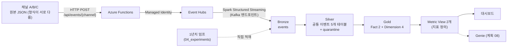
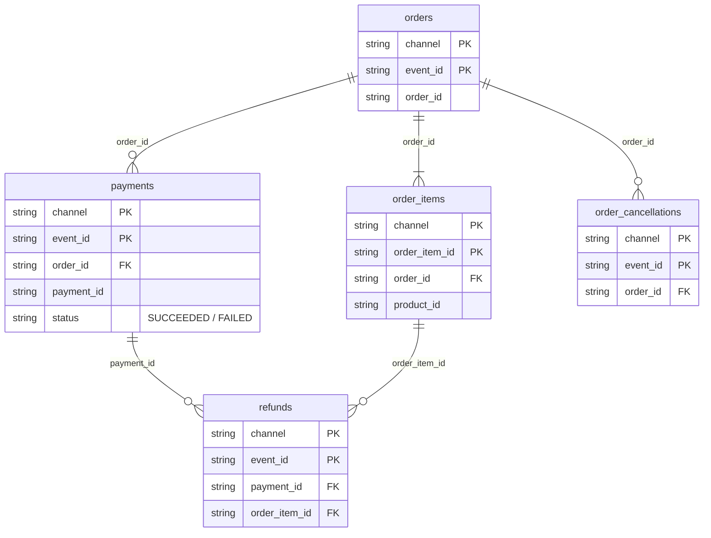
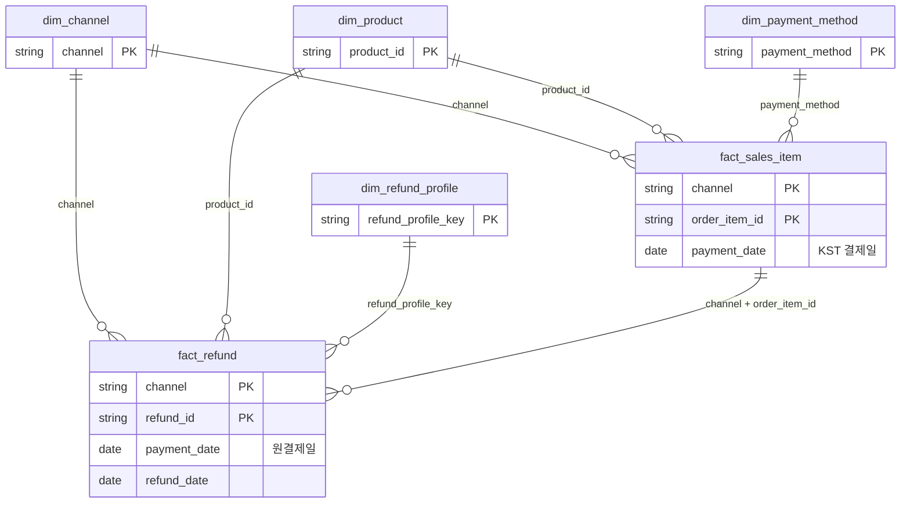

# 산출물 정리 (2026-10-15 기준)

세 판매 채널(A 자사몰, B 종합 오픈마켓, C 스포츠 전문몰)이 서로 다른 형식으로 보내는 주문·결제·환불 이벤트를 **하나의 공통 모델로 통합**하고, 결제일 기준 판매 지표를 **대시보드와 (이후) Genie가 같은 정의로** 쓰게 만드는 PoC다. 이 문서는 저장소 폴더(01~04) 순서로 무엇이 만들어졌는지만 정리한다. 컬럼 하나하나와 구현 세부는 각 폴더의 명세·코드를 본다.

## 전체 흐름

## 테이블 구조 (ERD)

### Silver: 공통 이벤트 모델

이벤트 유형별 테이블이다. 키는 `(channel, event_id)`이고, 업무 ID(`order_id`·`payment_id`·`order_item_id`)로 이어지는 관계는 논리적 관계이며 Gold에서 조인으로 푼다.

### Gold: 스타 스키마 (Kimball)

- 일자 차원(`dim_date`)은 두지 않는다. 날짜는 Fact의 `DATE` 컬럼(결제일·환불일)이고, 주 단위는 Metric View에서 결제일로 계산한다.
- 구조 레퍼런스는 `01_contracts/data_fixtures/A사_ERD.pdf`이고, 그중 `dim_date`만 제외했다.

---

## 01_contracts: 명세와 기준 데이터

프로젝트의 **단일 기준**이다. 구현은 여기에 맞춘다.

- **이벤트 명세** (`contracts/event_spec.md`)
  - 이벤트 5종: 주문 생성, 주문 취소, 결제 성공, 결제 실패, 환불 성공.
  - 채널마다 원본 형식이 다르다: 필드 표기(snake/camel/약어), 시간 형식(ISO UTC / epoch 밀리초 / KST 문자열), 이벤트 코드(`order.created` / `ORDER_PLACED` / `O01`).
  - 이 차이를 하나로 맞춘 **공통 이벤트 모델**과 Silver 테이블, 처리 규칙(중복·격리 사유), Gold와 지표 정의(6절)까지 담는다.
- **시나리오와 상품 기준 데이터** (`scenarios.json`, `skus.json`)
  - 정답 대조용 시나리오 9개를 세 채널에 같은 내용으로 적용한다(정상 주문, 취소, 결제 실패 후 재결제, 부분 환불, 중복 전송, 잘못된 값 등).
  - 상품 15개(SKU)는 모든 채널이 같이 쓴다.
- **고정 입력과 독립 기대값** (`data_fixtures/`)
  - 채널당 24건, 합계 72건의 원본 이벤트.
  - `expected.json`: 건수·금액·지표의 정답. 생성기와 로직을 공유하지 않는 별도 코드가 계산한다. 파이프라인이 맞는지는 항상 이 값과 대조한다.
- **이벤트 생성기** (`src/`): 시나리오를 채널별 원본 형식의 이벤트로 바꾼다. 같은 입력이면 항상 같은 결과다.
- 비고: 명세가 바뀌면 **명세 → 기대값 → 구현 → 테스트** 순서를 지킨다(구현에 맞춰 기대값을 고치지 않는다).

## 02_pipeline: 수집부터 Gold까지

### 수집 (`ingestion/`)

- **인프라:** 채널은 HTTP로 이벤트를 보낸다 → **Azure Functions**(Python HTTP 트리거)가 받는다 → **Managed Identity**로 **Azure Event Hubs**에 보낸다. 배포는 GitHub Actions.
- 채널은 URL 경로(`/api/events/A`)로 받아, 원본을 해석하지 않고 **봉투**에 담는다: `{channel, received_at, payload(원본 문자열)}`.
- 응답: 202 성공, 400 채널·인코딩 오류, 503 전송 실패(보내는 쪽이 1·2·4초로 재시도).
- 확인: 72건이 Event Hubs에 도착(2026-10-12).

### Bronze (`bronze/`) — 원본 보존

- 테이블 1개(`commerce_poc.bronze.events`)에 **모든 채널의 이벤트를 원본 그대로** 쌓는다.
- 컬럼은 봉투 3개(`channel`, `received_at`, `payload`)와 Event Hubs 위치·시각(`eh_partition`, `eh_offset`, `eh_enqueued_at`), 적재 시각(`ingested_at`).
- 비고
  - **payload는 해석하지 않고 문자열 그대로** 둔다. 필드 매핑·자료형 변환은 Silver에서 한다.
  - 중복·깨진 이벤트도 지우지 않는다(append only). 걸러내는 것은 Silver의 일이다.
  - Event Hubs의 Kafka 호환 엔드포인트를 Spark Structured Streaming으로 읽는다. 지금은 `availableNow` 트리거로, 실행할 때마다 쌓인 만큼 처리하고 멈춘다(상시 스트리밍은 계획 07 카드 7-F, 미착수).
- 확인: Databricks에서 72행, 재실행해도 행 수 유지(2026-10-12).

### Silver (`silver/`) — 통합의 핵심

- Bronze의 채널별 원본을 **공통 이벤트 모델로 변환**해 이벤트 유형별 5개 테이블(`orders`, `order_items`, `payments`, `refunds`, `order_cancellations`)에 쌓는다.
- 비고
  - 채널별 변환은 `channels/` 아래 채널 파일이 맡는다: 필드 이름, 시간대(C의 KST → UTC), 이벤트·결제수단·환불 코드를 공통 값으로 바꾼다.
  - **중복 제거:** `(channel, event_id)` 기준 최초 도착 1건만 남긴다. 저장은 insert-only MERGE라 다시 돌려도 행이 늘지 않는다(멱등).
  - **격리(quarantine):** 깨진 JSON, 모르는 이벤트 코드, 필수값 누락, 잘못된 값(음수 금액, 없는 SKU 등)은 버리지 않고 사유 코드와 함께 `quarantine`에 보관한다.
  - 결제가 주문보다 먼저 오는 등의 **순서 뒤바뀜은 격리하지 않는다**. 업무 ID 연결은 Gold에서 한다.
  - 변환은 지금 행마다 Python 함수(UDF)로 한다. Spark 네이티브 전환은 계획 07 카드 7-B(미착수).
- 확인: 로컬 테스트와 Databricks 실행으로 `expected.json` 건수 일치(2026-10-13).

### 품질 규칙 (`quality/`)

- 품질 규칙을 코드가 아니라 **데이터(`rules.json`)로 선언**한다: 행 규칙 9개(위반 이벤트를 격리), 집합 규칙 9개(PK 중복·정합성 등 테이블 단위 검사).
- 규칙 한 줄을 추가하면 검사가 늘어나는 구조다. 로컬 Spark로 확인했고, **파이프라인 연결은 아직 안 했다**(카드 7-B·7-C).

### Gold (`gold/`) — 지표용 스타 스키마

- **Fact 2개**
  - `fact_sales_item`: 결제에 성공한 주문의 상품 1개 = 1행. 결제일(KST), 결제수단, 결제 금액, 그 상품의 누적 환불.
  - `fact_refund`: 환불 1건 = 1행. **원결제일**과 환불일을 같이 갖는다.
- **Dimension 4개:** 채널, 상품(카테고리), 결제수단, 환불 프로필(유형·사유).
- 비고
  - 취소된 주문은 판매에서 뺀다. 지표는 **결제일 귀속(원거래 기준)**: 환불이 나중에 일어나도 원래 결제일의 실적에서 뺀다.
  - 지금은 Silver 전체로 Fact를 **다시 계산해 MERGE**(추가·갱신·삭제)한다. 바뀐 주문만 다시 계산하는 증분 처리는 카드 7-E(미착수).
  - `check_gold`가 PK 중복, FK 누락, 금액 정합성(결제금액 = 상품 합 + 배송비), 기대값 일치를 확인한다.
- 확인: Databricks에서 건수 일치와 정합성 OK(사용자 보고, 2026-10-14).

### 테스트 (`tests/`)

- 층별 폴더(`bronze`, `silver`, `gold`, `serving` 등)에서 결과를 **독립 기대값과 비교**한다. 로컬 테스트 통과는 Databricks 성공을 뜻하지 않으므로, 원격 실행은 따로 확인하고 그 전까지 '미검증'으로 적는다.

## 03_serving: 지표 정의와 대시보드

### Metric View (`metric_views/`) — 지표 정의를 한 곳에

- `commerce_poc.serving`에 2개를 만든다. 지표 공식은 이 정의에만 있고, 대시보드·Genie는 `MEASURE(지표)`로 불러 쓴다.
  - `sales_metrics` (원천 `fact_sales_item` + 채널·상품·결제수단 조인): 총판매금액, 환불금액, 순판매금액, 환불금액비율, 상품결제건수, 상품결제단가, 결제고객수, 객단가.
  - `refund_metrics` (원천 `fact_refund` + 채널·상품·환불 프로필 조인): 환불금액, 환불수량.
  - 분석 기준(나눠 볼 수 있는 축): 결제일, **결제주**(월요일 시작), 채널, 상품·카테고리, 결제수단, 환불 유형·사유.
- 비고
  - **비가산 지표**(결제고객수·객단가·비율·단가)는 식에 분자와 분모를 함께 넣어, 어떤 범위로 조회해도 그 범위에서 다시 계산된다(일별 값을 더하지 않는다).
  - YAML은 `metric_defs.py`가 만들고 노트북(`run_metric_views.py`)이 생성한다. `check_metric_views`가 기대값과 대조한다.
- 확인: Databricks에서 정합성 OK(사용자 보고, 2026-10-14). 결제주는 주별 조회 결과로 확인.

### 대시보드 (`dashboards/`)

- Databricks AI/BI(Lakeview) 대시보드. 정의(`dashboard_spec.py`)에서 JSON(`commerce_poc.lvdash.json`)을 만든다.
- 판매·환불 2페이지, 각 페이지 맨 위에 선택기(채널, 카테고리, 조회 기간, 비교 기간), KPI 숫자 카드, 비교 표, 주별 추이, 구성 막대, 상세 표.
- 비고
  - 데이터셋은 모두 Metric View를 `MEASURE()`로 조회하고, 선택값을 쿼리 매개변수로 받아 그 범위에서 지표를 다시 계산한다.
  - 다중 선택은 `array_contains(:channels, channel_name)`로 거른다(`IN (:channels)`는 로딩 오류가 났다).
  - 한계: 조회·비교 기간 그래프 겹쳐 그리기, 조건부 서식은 아직 없다. 쿼리가 길고 화면 서식(원·▲▼)이 SQL에 섞여 있어 정리가 필요하다.
- 확인: 시안 배치 버전은 Databricks에서 동작 확인(사용자, 2026-10-14). 선택기·비교 기간 직접 선택 버전은 미검증.

## 04_experiments: 1년치 덤프

- 실제 운영 규모를 흉내 내기 위한 **합성 데이터**. 설정(`configs/dump.json`)으로 기간(2025-10-15 ~ 2026-10-14), 하루 주문 수, 채널 비중·성장률(A 20%·+30%, B 50%·+15%, C 30%·+40%), 계절성, 시간대 분포, 환불율 변동을 정한다.
- 비고
  - 덤프는 Event Hubs를 거치지 않고 **Bronze에 직접 적재**한다(실험 한정, 일반 Backfill 기능이 아니다). 실제 수집 행과 겹치지 않게 `eh_partition = -1`을 쓴다.
  - 덤프용 독립 기대값(`results/expected_dump.json`)을 함께 만든다.
- 확인: Databricks 적재 확인(사용자). 대시보드 수준에서 기대값과 일치. **덤프 전수 대조(`check_*` 확장)와 성장 추세 점검은 남아 있다.**

---

## 지금 상태 한눈에

| 층 | 구현 | Databricks 확인 |
|---|---|---|
| 수집 (Functions → Event Hubs) | 완료 | 72건 도착 |
| Bronze | 완료 (`availableNow`) | 확인 |
| Silver | 완료 (UDF) | 확인 |
| 품질 규칙 | 규칙·검사 함수까지 | 파이프라인 미연결 |
| Gold | 완료 (전체 재계산) | 확인 (사용자 보고) |
| Metric View | 완료 (결제주 포함) | 확인 (사용자 보고) |
| 대시보드 | 시안 배치 + 선택기 | 시안 배치는 확인, 선택기 버전 미검증 |
| 1년치 덤프 | 적재 완료 | 전수 대조·성장 점검 남음 |
| 상시 스트리밍, 증분 처리, Spark 전환 | 계획 07 | 미착수 |
| Genie | 계획 08 | 미착수 |
